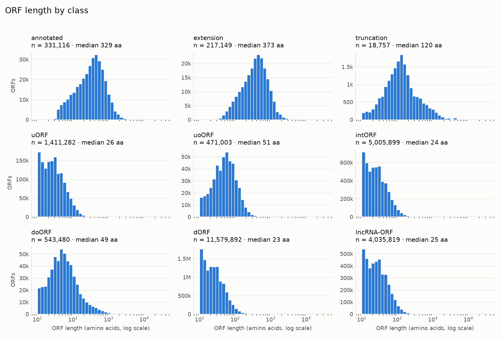
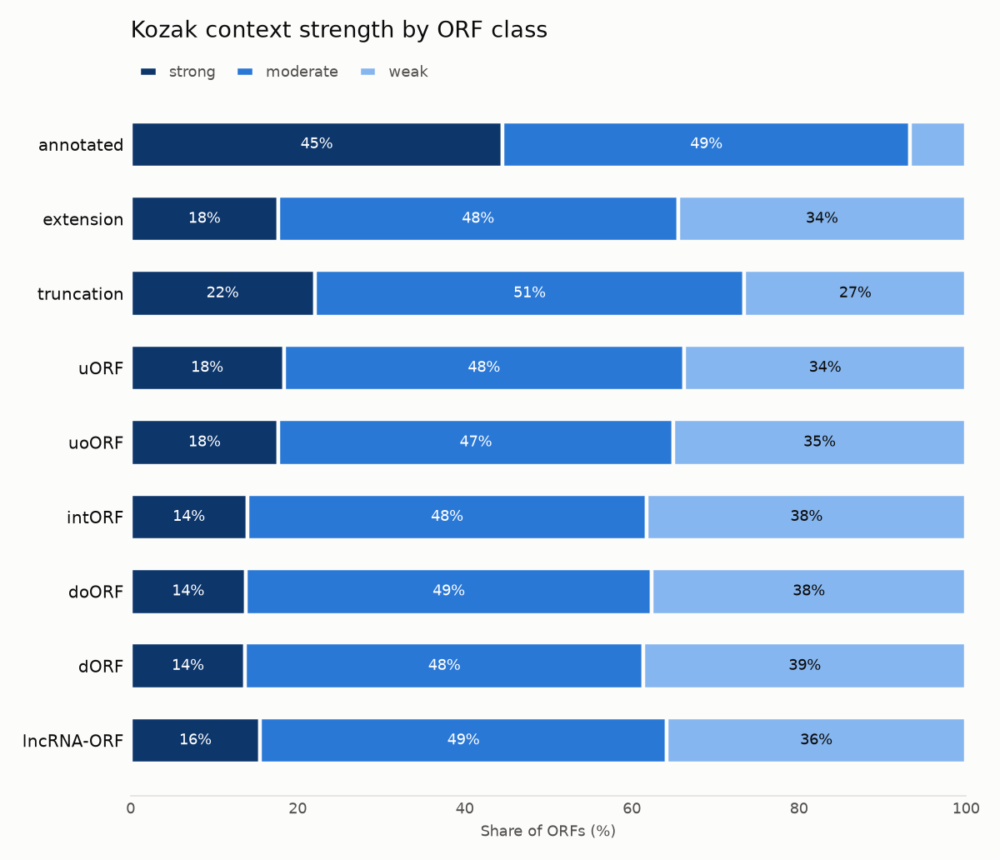

# ORF Profiler

[](https://github.com/LakshyaG7/orf-profiler/actions/workflows/ci.yml)

Find every open reading frame (ORF) in a set of transcripts, including the non-canonical ones that standard annotation leaves out, and describe the microprotein each would encode.

Given a transcript FASTA file (for example from [GENCODE](https://www.gencodegenes.org/human/)), ORF Profiler:

1. scans all three reading frames for ORFs, optionally including ORFs that begin at the near-cognate start codons CTG, GTG and TTG;
2. classifies each ORF by its position relative to the annotated coding sequence (upstream, overlapping, internal, downstream, or on a long non-coding RNA);
3. scores the Kozak context of each start codon;
4. computes the length, molecular weight, isoelectric point and hydrophobicity of each encoded peptide;
5. writes a table of ORFs, a peptide FASTA file, summary tables and figures.

## Why

Gene annotation has traditionally looked for long ORFs, so short ORFs in 5' UTRs, in alternative reading frames and on "non-coding" RNAs were mostly ignored. Ribosome profiling has since shown that thousands of them are translated in human cells and tissues, and some of the resulting microproteins have known functions (Chothani et al., 2022; Mudge et al., 2022).

Newly detected ORFs come with no functional data, so the first questions about them are answered from sequence alone: where does the ORF sit on the transcript, how good is its start-codon context, and what would the peptide look like? ORF Profiler answers those questions for every candidate ORF in a transcriptome.

## Install

Requires Python 3.10 or newer.

```bash
git clone https://github.com/LakshyaG7/orf-profiler.git
cd orf-profiler
python -m venv .venv && source .venv/bin/activate
pip install .
```

## Usage

```bash
orf-profiler scan gencode.v50.pc_transcripts.fa.gz --out results/pc --near-cognate --threads 4 --gzip
orf-profiler plot results/pc --out results/figures
```

| Option | Meaning | Default |
|---|---|---|
| `--out` | output folder | required |
| `--min-aa` | shortest ORF to report, in amino acids | 10 |
| `--max-aa` | longest ORF to report (e.g. `100` to keep only microprotein-sized ORFs) | no limit |
| `--near-cognate` | also report ORFs starting at CTG, GTG or TTG | off |
| `--threads` | worker processes | 1 |
| `--gzip` | compress `orfs.tsv` and `peptides.fa` | off |
| `--no-peptides` | skip `peptides.fa` | off |

The input can be plain or gzip-compressed. GENCODE headers are parsed for the CDS position; any other FASTA file also works, with every ORF labelled `lncRNA-ORF` because no CDS is known.

### Output

`scan` writes these files to the output folder:

| File | Contents |
|---|---|
| `orfs.tsv` | one row per ORF (columns below) |
| `peptides.fa` | the encoded peptide of every ORF |
| `class_summary.tsv` | number of ORFs, median length and start-codon usage per class |
| `length_hist.tsv` | ORF length distribution per class |
| `kozak_by_class.tsv` | Kozak strength counts per class |
| `run_info.json` | parameters, totals and the annotated-CDS check |

Columns of `orfs.tsv`:

| Column | Meaning |
|---|---|
| `orf_id` | `transcript_id:start-end` |
| `transcript_id`, `gene_id`, `gene_name` | from the FASTA header |
| `orf_class` | see [ORF classes](#orf-classes) |
| `frame` | reading frame, 1 to 3 |
| `start`, `end` | position on the transcript, 1-based and inclusive; `end` is the last base of the stop codon |
| `start_codon`, `stop_codon` | the codons themselves |
| `kozak_context` | bases from -6 to +4 around the start codon |
| `kozak_strength` | `strong`, `moderate`, `weak`, or `NA` at a transcript end |
| `aa_length` | peptide length in amino acids |
| `molecular_weight` | in daltons |
| `isoelectric_point` | pH at which the peptide carries no net charge |
| `gravy` | grand average of hydropathy (Kyte-Doolittle); positive is hydrophobic |

## How ORFs are called

- Transcripts are already in the mRNA sense orientation, so only the three forward frames are scanned.
- An ORF runs from a start codon to the first in-frame stop codon (TAA, TAG or TGA). ORFs that reach the end of the transcript without a stop are not reported.
- **One ATG ORF per stop codon.** If several in-frame ATGs precede a stop, the most upstream one is used, giving the longest ORF.
- **Near-cognate starts** (`--near-cognate`). If a CTG, GTG or TTG lies in frame upstream of the first ATG, or there is no ATG at all, a second ORF starting there is reported for the same stop codon. Near-cognate codons downstream of an ATG are not reported, because a scanning ribosome would reach the ATG first.
- The first residue of every peptide is methionine, since initiation uses the initiator Met-tRNA even at near-cognate codons.

### Kozak context

The two positions with the largest effect on start-codon recognition are -3 and +4, counting the A of ATG as +1 (Kozak, 1986). A purine (A or G) at -3 and a G at +4 is scored `strong`, one of the two `moderate`, and neither `weak`.

### ORF classes

Class names follow the convention used for ribosome-profiling ORFs (Mudge et al., 2022).

| Class | Definition |
|---|---|
| `annotated` | same start and stop as the annotated CDS |
| `extension` | same stop as the CDS, starts upstream (N-terminal extension) |
| `truncation` | same stop as the CDS, starts downstream of the annotated start |
| `uORF` | upstream ORF, ends before the CDS starts |
| `uoORF` | upstream overlapping ORF, starts in the 5' UTR and runs into the CDS in another frame |
| `intORF` | internal ORF, inside the CDS in another frame |
| `doORF` | downstream overlapping ORF, starts in the CDS and ends in the 3' UTR |
| `dORF` | downstream ORF, starts after the CDS ends |
| `lncRNA-ORF` | the transcript has no annotated CDS |

## Results on GENCODE v50

Running the workflow on all human protein-coding and lncRNA transcripts in GENCODE release 50 (579,623 transcripts, `--min-aa 10 --near-cognate`) gives 23.6 million candidate ORFs, 94% of them 100 amino acids or shorter. The run takes about 8 minutes on 2 cores.

| Class | ORFs | Median length (aa) | ATG start | Kozak strong / moderate / weak |
|---|---:|---:|---:|---:|
| `annotated` | 331,116 | 329 | 100% | 45% / 49% / 7% |
| `extension` | 217,149 | 373 | 8% | 18% / 48% / 34% |
| `truncation` | 18,757 | 120 | 53% | 22% / 51% / 27% |
| `uORF` | 1,411,282 | 26 | 24% | 18% / 48% / 34% |
| `uoORF` | 471,003 | 51 | 15% | 18% / 47% / 35% |
| `intORF` | 5,005,899 | 24 | 38% | 14% / 48% / 38% |
| `doORF` | 543,480 | 49 | 37% | 14% / 49% / 38% |
| `dORF` | 11,579,892 | 23 | 36% | 14% / 48% / 39% |
| `lncRNA-ORF` | 4,035,819 | 25 | 36% | 16% / 49% / 36% |



Annotated coding sequences stand apart from everything else: they are an order of magnitude longer, and 45% of them have a strong Kozak context against 14 to 18% for the other classes. Those sit close to what random sequence would give (12.5% strong, 50% moderate and 37.5% weak for equal base frequencies).



### Check against the annotation

The annotated CDS is never used to find ORFs, only to label them afterwards, so recovering it is a test of the ORF finder. Of the 382,428 protein-coding transcripts, 348,033 have a complete CDS (it starts with ATG, ends with a stop codon and has no stop inside). The scan reports an ORF ending at the annotated stop codon for all 348,033:

- 330,652 (95.0%) with exactly the annotated start;
- 17,381 (5.0%) as an `extension`, because an in-frame ATG lies upstream of the annotated start with no stop codon in between.

The other 34,395 transcripts have a CDS that is incomplete at one end, starts at a non-ATG codon or reads through a stop codon, and cannot be recovered by any ORF scan.

## Reproduce with Snakemake

The workflow downloads the two GENCODE FASTA files if they are not already in `data/`, scans both and draws the figures:

```bash
pip install ".[workflow]"
snakemake --cores 4
```

Settings (GENCODE release, folders, minimum length, near-cognate starts) are in [`workflow/config.yaml`](workflow/config.yaml) and can be overridden on the command line, for example `snakemake --cores 4 --config gencode_release=49`.

## Docker

```bash
docker build -t orf-profiler .
docker run --rm -v "$PWD/data:/data" orf-profiler scan /data/transcripts.fa --out /data/results
```

## Tests

```bash
pip install -e ".[dev]"
pytest
```

The tests cover the ORF finder on hand-built sequences (each frame, each stop codon, nested starts, near-cognate starts, length cut-offs), every ORF class, Kozak scoring, peptide features against known values, and an end-to-end run on real GENCODE transcripts including *SMIM1*, a 78-amino-acid microprotein. The Snakemake workflow test runs when Snakemake is installed.

## Limitations

- **These are candidate ORFs, not translated ORFs.** The scan works from sequence alone and most of what it reports is never translated. Deciding which candidates are real needs experimental evidence such as ribosome profiling (Ribo-seq) or mass spectrometry. ORF Profiler describes candidates; it does not rank them.
- Only CTG, GTG and TTG are considered as near-cognate start codons. Other near-cognate codons (such as ACG) can also initiate translation and are not reported.
- Only the longest ORF per stop codon is reported for each start type, so an ORF that begins at a downstream in-frame ATG is not listed separately.
- Transcript isoforms of a gene share most of their sequence, so the same ORF is reported once per isoform. Counts are per transcript, not per genomic locus.
- The Kozak score uses two positions. It is a coarse summary, not a model of initiation efficiency.
- Peptide features assume an unmodified linear peptide with an N-terminal methionine.

## References

- Chothani SP, Adami E, Widjaja AA, et al. A high-resolution map of human RNA translation. *Molecular Cell* 82(15):2885-2899 (2022).
- Mudge JM, Ruiz-Orera J, Prensner JR, et al. Standardized annotation of translated open reading frames. *Nature Biotechnology* 40:994-999 (2022).
- Kozak M. Point mutations define a sequence flanking the AUG initiator codon that modulates translation by eukaryotic ribosomes. *Cell* 44(2):283-292 (1986).
- Cock PJA, Antao T, Chang JT, et al. Biopython: freely available Python tools for computational molecular biology and bioinformatics. *Bioinformatics* 25(11):1422-1423 (2009).

## License

MIT
